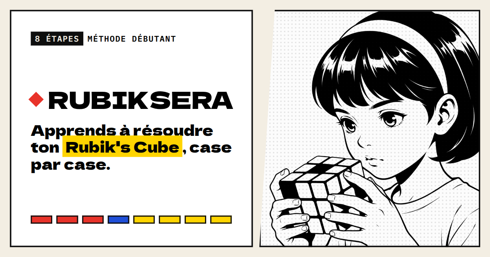

# rubiksera, the Rubik's Cube step by step

<p align="center"></p>

Interactive 3D Rubik's Cube visualization that walks through the **8 steps of
Victor Colin's beginner method**, with synchronized text in French or English.

> Visualisation interactive d'un Rubik's Cube en 3D qui déroule pas à pas les 8 étapes
> de la méthode débutant de Victor Colin, avec le texte synchronisé en français ou anglais.

## Demo

🎬 Live demo: https://rubiksera.bradfo.me/
📖 Original tutorial (in French): https://youtu.be/Leml4U4D1r8

## Features

- 📖 **A manga planche**: the whole tool is a comic page, with inked panels, paper
  gutters, screentone and speed lines around the cube
- 👧 **A teacher in a speech bubble**: the girl from the logo explains each step,
  with Victor Colin's text kept word for word and one key word highlighted
- 🧊 **Inked 3D cube** (Three.js): cel shaded in three flat tones, every cubie
  outlined in ink, halftone shadow, gentle idle rotation (drag to rotate, scroll to zoom)
- 🎨 **A colour code that teaches**: the 3 phases of the method each have a colour
  (red for the first layer, blue for the second layer, yellow for the yellow face),
  used for the chapter label, the highlighted word and the 8 page buttons
- 🎯 **Move cards**: a mini isometric cube with the turning layer in colour and a
  rotation arrow, the notation in big letters, the face and direction in plain words,
  and a bar under the card for the direction (red clockwise, blue counter clockwise,
  yellow half turn)
- 💥 **Onomatopoeia**: "CLIC !" when a step ends, "BRAVO !" when the cube is solved
- 🎬 **Step by step playback** with play, pause, previous, next and page buttons
- 🎚 **Speed slider** (0.3x to 2x), saved in localStorage
- 🌍 **i18n** (FR / EN), detected from the browser language, switchable on the fly
- 🤖 **Custom LBL solver** (`js/lblSolver.js`): each step's moves really do what the text says
- 📸 **Camera flip** at step 4, as the sheet says ("put the white face down")
- 📱 **Mobile layout** with a sticky play bar, the cube always stays on screen

## How to run locally

```bash
python3 -m http.server 8000
```

Then open http://localhost:8000

No build step, no dependencies. Pure HTML + CSS + ES modules. Three.js loaded
from CDN via importmap.

Checks (phase mapping, highlight words, copy rules) run with Node, no install needed:

```bash
node --test tests/*.test.mjs
```

## Project structure

```
.
├── index.html
├── sitemap.xml               # Sitemap for search engines
├── robots.txt                # Crawl rules (everything allowed) + sitemap link
├── llms.txt                  # Plain summary of the site and the 8 steps for AI assistants
├── favicon.ico               # Favicon 16/32/48 for browsers and search results
├── site.webmanifest          # App name and icons for phones
├── assets/
│   ├── brand/                # Logo, teacher face crop, social preview image
│   ├── favicon.png           # Favicon (the teacher and her cube), plus icon-192/512
│   ├── apple-touch-icon.png
│   └── rubiks.pdf            # Original methodology sheet by Victor Colin
├── css/
│   └── style.css
├── js/
│   ├── main.js               # UI orchestration
│   ├── cube3d.js             # Three.js 3D rendering + face rotation animation
│   ├── moveIcons.js          # SVG generator for the 3D move cards
│   ├── i18n.js               # Mini i18n engine
│   ├── steps.js              # Step data (titles/bodies from i18n, moves precomputed)
│   ├── phases.js             # Step to phase mapping + title highlight split
│   ├── cubeEngine.js         # Facelet model + 18 move permutations (engine)
│   └── lblSolver.js          # Layer-by-layer solver
├── i18n/
│   ├── fr.js                 # French strings + 8 steps (faithful to PDF)
│   └── en.js                 # English translation
├── scripts/
│   └── precompute.mjs        # Node script to recompute move lists for a new scramble
└── tests/                    # node --test checks (phases, copy rules)
```

## Change the scramble

The 8 step move lists are **pre-computed** for a fixed scramble (in `js/main.js`).
If you change the `SCRAMBLE` constant, you need to re-run the solver to get
new move lists:

```bash
node scripts/precompute.mjs
```

Copy the output into `PRECOMPUTED_STEPS` in `js/main.js`.

## Credit

Method and methodology sheet by **Victor Colin**.
[YouTube tutorial](https://youtu.be/Leml4U4D1r8) (in French).
This site faithfully reproduces the text and formulas of `rubiks.pdf`.

> Merci Victor pour ton tuto ! 🙏

## License

This project is for educational purposes. The methodology and PDF belong to
Victor Colin. The code is released under the [MIT License](LICENSE).
